<h1 align="center">✨ MadoNite 16.40</h1>

<p align="center">
  <strong>Magia Exedra character models in Fortnite.</strong><br>
  Madoka, Homura, Mami, Sayaka, Kyoko and Mabayu as playable outfits in Fortnite Chapter 2 Season 6 (16.40).
</p>

### Fortnite builds and launcher

These are external resources for the **Windows 16.40-CL-16218553** build and its launcher. They are separate from MadoNite.

<table>
  <tr>
    <td valign="top" width="33%">
      <h3>📚 Build archive</h3>
      <p><a href="https://github.com/Aorux01/all-fortnite-builds"><strong>Aorux01 / all-fortnite-builds</strong></a></p>
      <p>A community index with an entry for Fortnite 16.40. The GitHub repository was reachable when checked; its external download server could not be verified.</p>
    </td>
    <td valign="top" width="33%">
      <h3>🧾 Windows manifest</h3>
      <p><a href="https://github.com/VastBlast/FortniteManifestArchive/blob/main/Fortnite/Windows/PlBdWqpuSh7V8Uc_yUG5gX8HFLPwag.manifest"><strong>VastBlast / FortniteManifestArchive</strong></a></p>
      <p>Metadata for the matching build, <strong>not a copy of the game</strong>. Availability of the game content it references may change.</p>
    </td>
    <td valign="top" width="33%">
      <h3>🚀 Launcher</h3>
      <p><a href="https://github.com/Auties00/Reboot-Launcher"><strong>Auties00 / Reboot-Launcher</strong></a></p>
      <p>Used to launch the 16.40 client and host or join a lobby. Install it separately; it is not bundled with MadoNite.</p>
    </td>
  </tr>
</table>

These projects are maintained independently from MadoNite. Check the build number before installing the mod.

### In-game

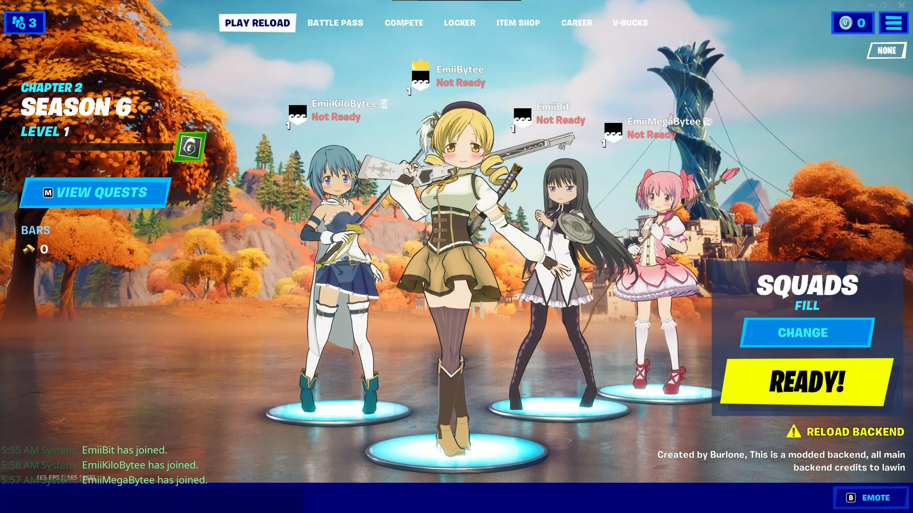

<p align="center"><em>Four members of the quintet together in the lobby. Yes, this is an in-game screenshot.</em></p>

### The six outfits

The locker poses and props help each character feel like herself: Mabayu has her scissors, Kyoko her spear, Mami her musket, and the others their own familiar gear.

<table>
  <tr>
    <td align="center" width="50%"><strong>Sayaka Miki</strong><br>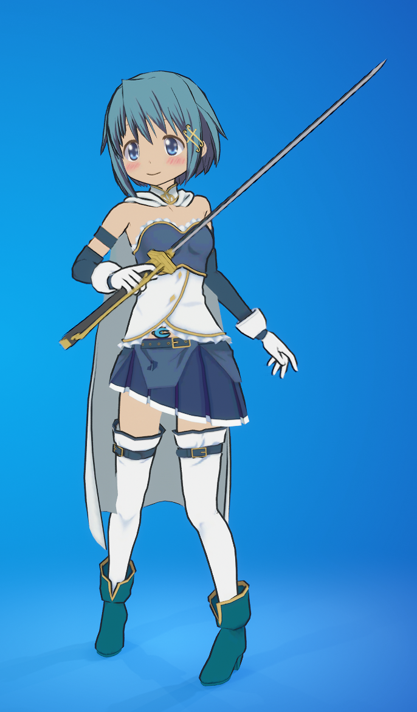</td>
    <td align="center" width="50%"><strong>Mami Tomoe</strong><br>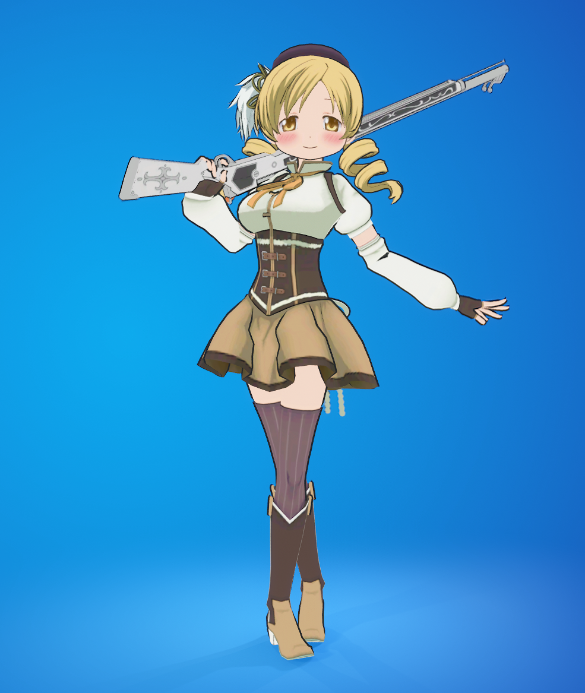</td>
  </tr>
  <tr>
    <td align="center"><strong>Homura Akemi</strong><br>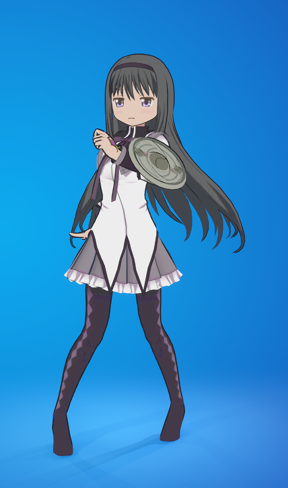</td>
    <td align="center"><strong>Madoka Kaname</strong><br>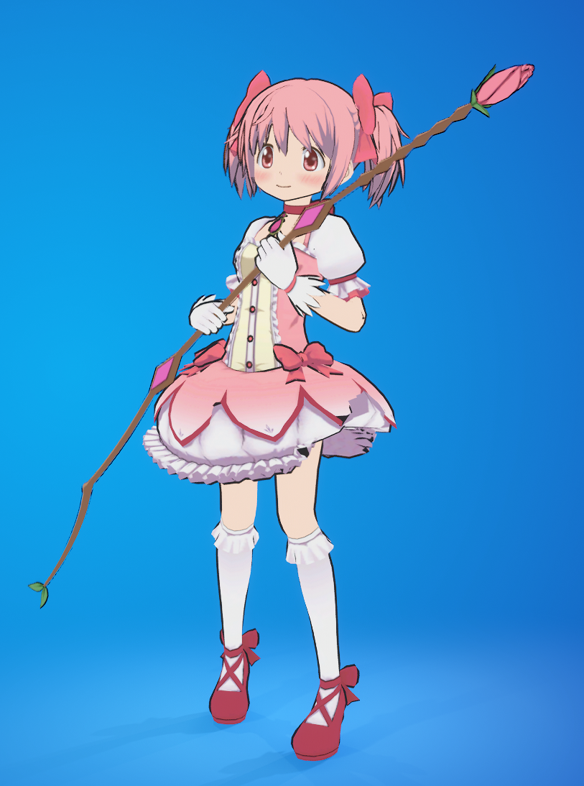</td>
  </tr>
  <tr>
    <td align="center"><strong>Kyoko Sakura</strong><br>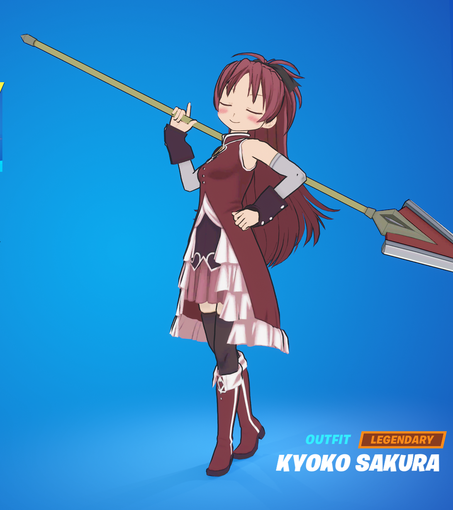</td>
    <td align="center"><strong>Mabayu Aki</strong><br>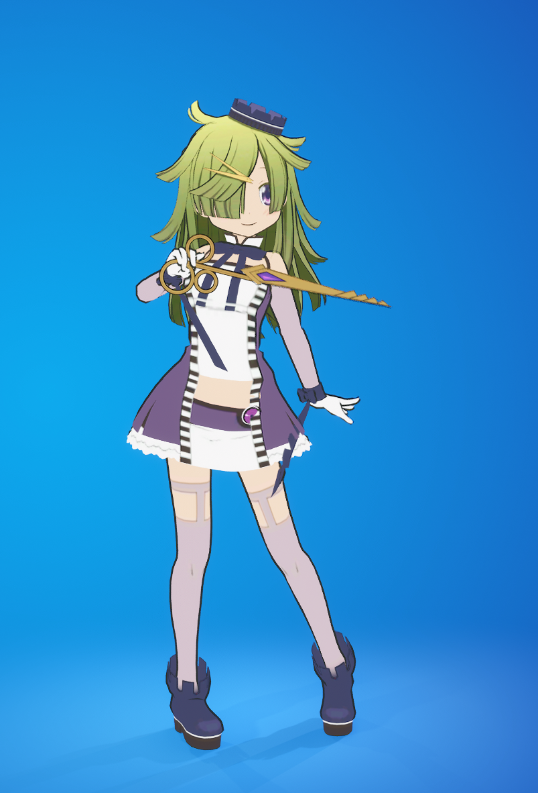</td>
  </tr>
</table>

### Along the way

The colors, faces, outlines, poses and physics took a lot of iterations. The following screenshots are **earlier development builds**; they are part of the process, not exact previews of the current package.

<table>
  <tr>
    <td align="center" width="50%"><strong>Mabayu: earlier locker test</strong><br>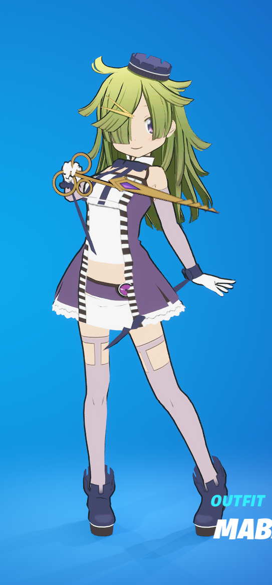</td>
    <td align="center" width="50%"><strong>Mabayu: earlier lobby test</strong><br>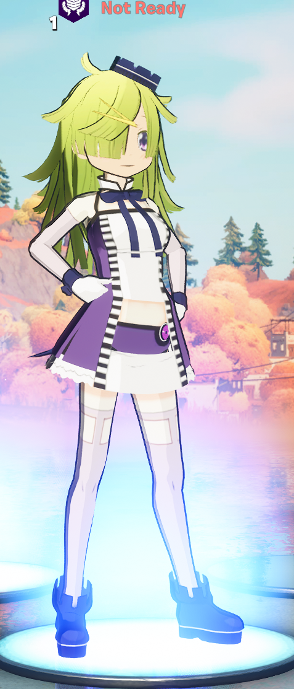</td>
  </tr>
  <tr>
    <td align="center"><strong>Madoka: lobby test</strong><br>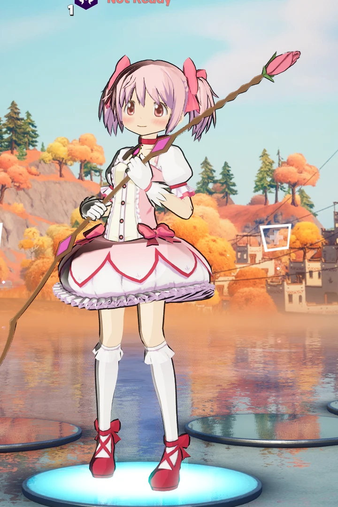</td>
    <td align="center"><strong>Sayaka: locker test</strong><br>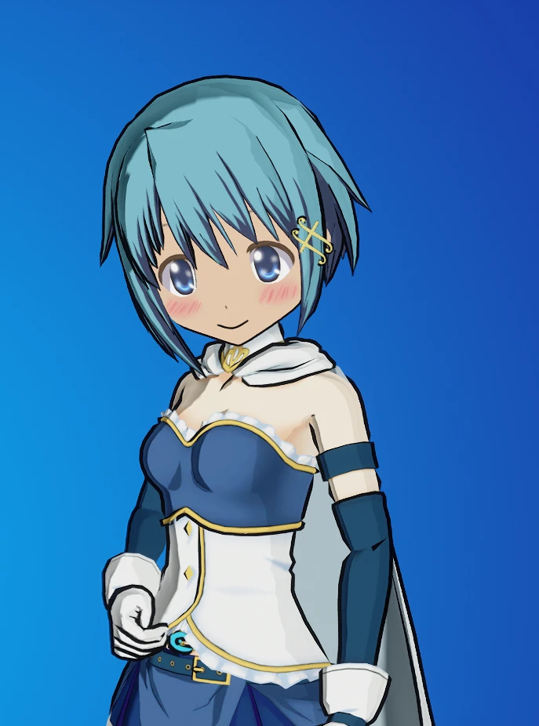</td>
  </tr>
</table>

### What went into this?

This is more than a texture swap. Each character needs a model, materials, icon and references tied to a CID slot. We worked on locker poses and visible props, tuned the shading toward *Magia Exedra*'s anime look and made the outlines work in game.

The work started in **Blender**: fitting meshes to Fortnite's skeleton, adjusting skin weights and comparing renders with real game captures. Mabayu's face was particularly tricky. It looked too realistic in Fortnite compared with Blender, so its materials, shine, blush and shading were revised. Hair, clothing and props also needed pose and deformation fixes.

To keep the animations working, bone references were mapped by name without changing local vertex-weight indices. Hair and some skirts use character-specific physics. For Kyoko, **the skirt moves while the coat stays rigid**, following the result of in-game tests. In **v1**, Mabayu's wrist ribbons are separate parts that hang from her forearms with Fortnite's cape physics, angled away from her body so they no longer pass through her legs. Mabayu's assets were isolated under `/Game/MabayuMod` so original characters such as Recruit keep their normal appearance.

The assets were then prepared with **Unreal Engine 4.26.1** and packed into **IoStore** containers (`.pak`, `.utoc`, `.ucas`). Changes were checked in the locker and in matches: poses, silhouettes, hair and clothing while running or descending, and possible effects on other outfits.

| Tool | Role in the project |
|---|---|
| **Blender 4.5** | Meshes, rigging, weights, materials, poses and comparison renders. |
| **FModel and CUE4Parse** | Inspecting and validating Fortnite assets and containers. |
| **Unreal Engine 4.26.1** | Preparing and cooking assets for Fortnite 16.40. |
| **Python and PowerShell** | Conversion, packaging, audits, reversible changes and hash checks. |
| **GitHub Releases** | Distributing the verified Windows kit separately from the documentation. |

### Trying the mod

You need **Fortnite `++Fortnite+Release-16.40-CL-16218553`**. The Release ZIP contains the client mod; this repository's Code tab contains its documentation. Neither includes the base game, a launcher or a backend. The six CIDs must be granted by the backend you use for the outfits to appear in the locker.

The kit (**v1**) contains **274 files**: a modified executable and 91 package groups. Download **`MadoNite-1640-v1-portable.zip` from the [v1 release](https://github.com/EmiiBytee/MadoNite-1640/releases/tag/v1)**; the repository's Code ZIP contains documentation only. Close the game, back up the original executable, copy the contents of the release ZIP's `16.40/` folder over your Fortnite 16.40 folder and verify the hashes. Run this command from the extracted release folder:

```powershell
powershell -NoProfile -ExecutionPolicy Bypass -File ".\comprobar_mod.ps1" -GameRoot "C:\path\to\Fortnite\16.40"
```

The checker should report that all 274 files match the manifest. It only reads files. See [INSTALLATION.md](INSTALLATION.md) for the full instructions and rollback steps.

For the **v1 Release ZIP**, SHA-256 is `E54E4E37CAF1EBF2E84854FFD742CA30096DEC60FF42F4FF3F980F85C77478E0`. You can compare it with the included `.sha256` file and view the [VirusTotal report for this exact ZIP](https://www.virustotal.com/gui/file/e54e4e37caf1ebf2e84854ffd742ca30096dec60ff42f4ff3f980f85c77478e0/detection). The report is a third-party scan, not a guarantee of safety.

### Current state and credits

The current package passed SHA-256 verification. In game, Mabayu was checked in the locker and in a match, including hair and skirt movement while running and descending. The Mabayu and Kyoko locker cards appeared, and Recruit kept its normal appearance. **Kyoko's model was not selected again during the final test of this package**, although her card remained available. Development is ongoing.

MadoNite is an unofficial fan project by **Emii**, with help from **Claude Code** and **OpenAI Codex** during investigation, testing and documentation. It is not affiliated with Epic Games or the owners of *Magia Exedra*. The games, characters and assets belong to their respective rights holders.

The launcher is by [Auties00 and the Reboot-Launcher contributors](https://github.com/Auties00/Reboot-Launcher). Reboot credits [Milxnor / Project-Reboot-3.0](https://github.com/Milxnor/Project-Reboot-3.0) for the game server and [Lawin0129 / LawinServer](https://github.com/Lawin0129/LawinServer) and [FortMatchmaker](https://github.com/Lawin0129/FortMatchmaker) for the backend and matchmaking. These are separate projects and their contributors are not MadoNite contributors.
